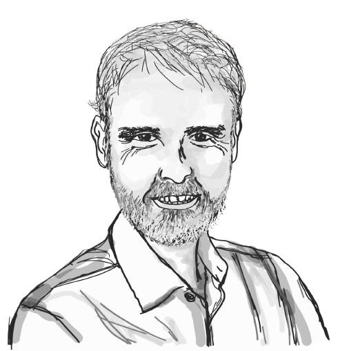

```{=html}
<style>
/* Hide Quarto's automatically generated title/subtitle/date block on episode pages. */
#title-block-header,
.quarto-title-block {
  display: none;
}
</style>
```

::: {.episode-shell}
::: {.episode-hero}
<p class="eyebrow">Season 2 · Episode 10</p>

# The Earth as a Cybernetic System

How does the Earth regulate its carbon cycle, and what happens when climate feedbacks begin to amplify warming? Climate scientist Pep Canadell explores the intricate relationships between carbon emissions, natural sinks and planetary stability, revealing how understanding these interconnected processes can inform our collective response to climate change and net zero.

::: {.audio-card}
## Listen

```{=html}
<div class="listen-links" aria-label="Listen to this episode on external platforms">
  <a class="listen-icon-link" href="https://open.spotify.com/episode/XXX" target="_blank" rel="noopener noreferrer" aria-label="Listen on Spotify">
    <i class="bi bi-spotify" aria-hidden="true"></i>
    <span class="visually-hidden">Spotify</span>
  </a>
  <a class="listen-icon-link" href="https://youtu.be/ZgkE_8pBJns" target="_blank" rel="noopener noreferrer" aria-label="Watch on YouTube">
    <i class="bi bi-youtube" aria-hidden="true"></i>
    <span class="visually-hidden">YouTube</span>
  </a>
</div>
```
:::
:::

## Guest speaker

::: {.speaker-card}
::: {.speaker-photo}
{fig-alt="portrait_pep"}
:::

::: {.speaker-bio}
### Pep Canadell
 
Dr Pep Canadell is a Chief Research Scientist at CSIRO Environment, Executive Director of the Global Carbon Project, and Honorary Professor at the Australian National University's Fenner School of Environment and Society.
Originally trained in biology and terrestrial ecology at the University Autonomous of Barcelona, Catalonia in Spain, Pep has built an international research career spanning the United States and Australia. His research focuses on global greenhouse gas budgets, the vulnerability of Earth's carbon sinks, carbon–climate feedbacks, and pathways to net-zero emissions. He has contributed to the Intergovernmental Panel on Climate Change (IPCC) for over two decades, authored more than 300 peer-reviewed papers, and is a Fellow of the Australian Academy of Science and other leading scientific academies.
Recognised among the world's most influential climate scientists, Pep actively connects scientific research with climate policy, decarbonisation strategies, and public understanding of climate change.


:::
:::


## Quick quiz

```{=html}
<div class="quiz-card interactive-quiz">
  <div class="quiz-stage" aria-live="polite"></div>

  <script type="application/json" class="quiz-data">
  [
    {
      "question": "According to Pep Canadell, what does the global carbon budget help us understand?",
      "options": [
        {
          "text": "The balance between carbon emissions, removals and atmospheric accumulation",
          "correct": true,
          "feedback": "Exactly! The global carbon budget tracks carbon sources and sinks, revealing how much carbon dioxide accumulates in the atmosphere. It also helps estimate the remaining emissions compatible with climate targets."
        },
        {
          "text": "The total amount of carbon stored in forests alone",
          "correct": false,
          "feedback": "Forests are important carbon sinks, but the global carbon budget considers emissions and removals across the entire Earth system, including oceans and human activities."
        },
        {
          "text": "The financial cost of climate policies worldwide",
          "correct": false,
          "feedback": "Pep uses a financial budget as an analogy, but the global carbon budget accounts for physical carbon flows rather than financial expenditure."
        },
        {
          "text": "The amount of carbon dioxide produced only by natural processes",
          "correct": false,
          "feedback": "The global carbon budget includes emissions from human activities as well as natural processes, together with carbon removals."
        }
      ]
    },
    {
      "question": "Which example best illustrates a positive carbon–climate feedback discussed in the episode?",
      "options": [
        {
          "text": "A longer growing season allowing plants to absorb more carbon dioxide",
          "correct": false,
          "feedback": "Greater plant uptake can partially counteract rising atmospheric carbon dioxide. Pep describes this as one of the processes complicating the overall carbon balance in northern regions."
        },
        {
          "text": "Reforestation increasing carbon storage in vegetation",
          "correct": false,
          "feedback": "Reforestation can remove carbon dioxide from the atmosphere, helping mitigate warming rather than amplifying it."
        },
        {
          "text": "Warming contributing to boreal wildfires that release more carbon and intensify warming",
          "correct": true,
          "feedback": "Exactly! Pep explains how warming can contribute to intense fires in boreal regions. These fires release stored carbon and alter surface conditions, potentially reinforcing further warming. This is a positive feedback because it amplifies the initial change."
        },
        {
          "text": "Renewable energy replacing fossil-fuel electricity generation",
          "correct": false,
          "feedback": "Replacing fossil fuels with renewable energy reduces human-caused emissions. It is a mitigation strategy rather than a positive carbon–climate feedback."
        }
      ]
    },
    {
      "question": "Why does Pep emphasise reducing emissions rather than relying heavily on carbon removal to reach net zero?",
      "options": [
        {
          "text": "Natural carbon sinks no longer absorb any emissions",
          "correct": false,
          "feedback": "Natural sinks continue to absorb substantial amounts of carbon dioxide. However, Pep warns that their future capacity may decline as the climate warms."
        },
        {
          "text": "Carbon removal is already inexpensive enough to replace emissions reduction",
          "correct": false,
          "feedback": "Pep explains that engineered carbon removal remains expensive and energy-intensive, with additional challenges associated with permanent storage."
        },
        {
          "text": "Electrification cannot contribute meaningfully to decarbonisation",
          "correct": false,
          "feedback": "Quite the opposite! Pep identifies widespread electrification, supported by renewable electricity, as one of the most promising pathways for reducing emissions."
        },
        {
          "text": "Natural sinks are vulnerable, while engineered carbon removal remains costly and energy-intensive",
          "correct": true,
          "feedback": "Exactly! Forests face increasing risks from drought and fire, while engineered removal technologies are expensive and require substantial energy. Pep therefore argues that reducing emissions in the first place is essential."
        }
      ]
    }
  ]
  </script>

  <noscript>
    <p>This quiz needs JavaScript to reveal questions and answer feedback interactively.</p>
  </noscript>
</div>
```


## Transcript

<details class="transcript-toggle" tabindex="0">
<summary>Open transcript</summary>
<div class="transcript-content">


 </div>
</details>


:::
